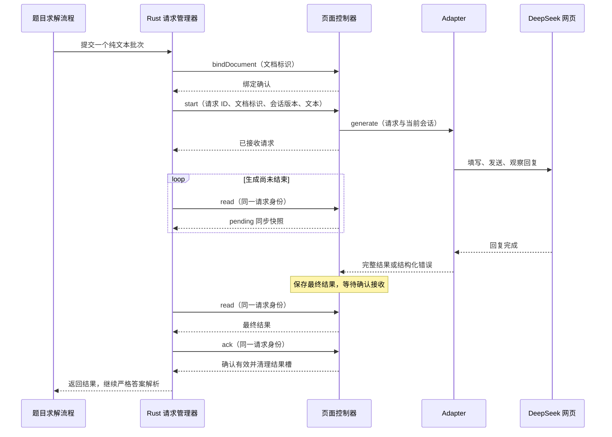
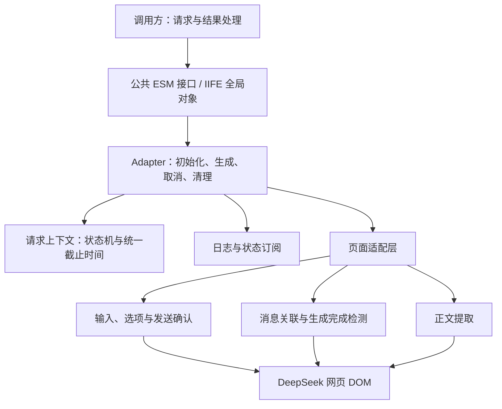
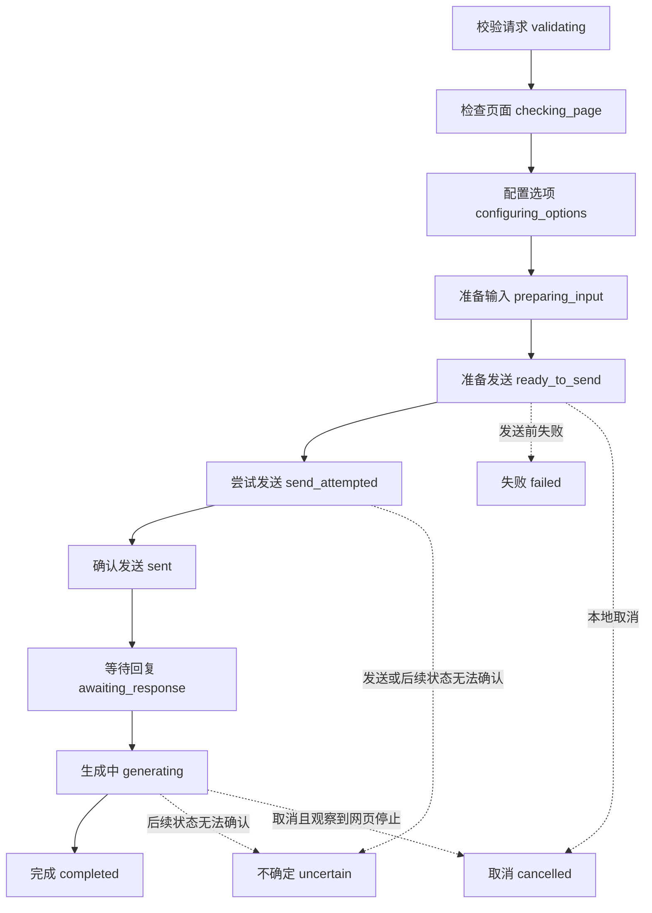

# uXueScript：DeepSeek 网页求解器集成

[uXueScript](https://github.com/unraous/uxuescript) 是基于 Vue、Rust 和 Tauri 的学习通辅助客户端。本次贡献为其题目求解流程增加 DeepSeek 网页模式：读取原有题目数据，通过网页生成答案，再解析为应用已有的答案格式，供后续处理使用。

我负责这一功能分支的方案设计、AI 辅助开发、集成与验证。独立模块的网页操作细节见 [DeepSeek Web Adapter](https://github.com/Nuwanda218/nuwanda218/blob/main/projects/deepseek-web-adapter.md)，本文主要说明如何在已有应用中接入它。

[功能分支](https://github.com/Nuwanda218/uxuescript/tree/feat/nuwanda-web-solver) · [上游 PR #61](https://github.com/unraous/uxuescript/pull/61) · [首页入口改进提案 #62](https://github.com/unraous/uxuescript/issues/62)

## 复用原有题目处理链

题目提取、材料组织、批处理、提示词和答案结构已经由上游应用提供。新增网页模式的任务，是增加一种生成方式，而不是重新实现整条题目业务链。因此，集成保留原求解器选择接口，让网页模式与原有模型 API 模式分别处理生成请求，再返回相同的答案数据结构。

网页模式先检查整卷输入并准备所有批次，再逐批发送，只有所有批次都通过严格 JSON 和题目对应关系校验才返回答案。这样既复用现有处理规则，也避免前一批已生成、后一批失败时把不完整结果交给后续填写流程。网页模式不会自动重试或回退到模型 API。

主要代码入口是 `src-tauri/src/core/quiz/web/deepseek.rs`；求解器设置与登录引导位于 `src/components/TheConfigPanel/TheSolverPanel.vue`。

## 将独立模块接入原构建流程

集成采用 vendor 方式，将 Adapter 固定版本的 14 个 JavaScript 运行模块纳入 `injected/deepseek-web/adapter-core/`。模块保留相对目录与运行逻辑，少数文件仅增加宿主类型检查和 lint 所需的注解；`UPSTREAM.md` 记录来源提交、差异和更新规则。

这种方式让页面脚本跟随应用版本构建，避免发布时还要另行下载或手工替换一份外部 IIFE。`scripts/build-scripts.mjs` 复用既有打包流程生成独立脚本，Rust 再将产物注入 DeepSeek WebView。更新 Adapter 时需要显式选择版本、同步源码并检查差异，目前不自动同步。

## Rust 与 JavaScript 如何交接异步结果

网页生成通常需要数秒，而 Rust 的一次 `eval_with_callback` 只能读取脚本当次同步返回的内容。直接把网页中的 Promise 当作同步结果，无法可靠判断生成何时结束，也无法处理刷新和会话切换后的迟到回调。

因此，页面控制器负责启动和跟踪异步生成；Rust 通过短调用读取同步 JSON 状态。控制接口为 `bindDocument / start / read / cancel / ack`：先确认页面身份，启动请求，然后读取状态，最后确认接收结果。



三种身份信息各自处理一种变化：

| 信息 | 解决的问题 | 代码名称 |
| --- | --- | --- |
| 请求 ID | 区分每次生成，识别重复启动和迟到结果 | `requestId` |
| 页面文档标识 | 区分刷新、导航前后的文档，避免旧文档回调影响新页面 | `documentToken` |
| 会话重新绑定时更新的版本号 | 即使没有整页刷新，也能识别单页应用内的会话切换；切回原路径也不能复用旧结果 | `bindingGeneration` |

页面只保留一个活动请求及其结果。同一身份重复 `start` 只确认原请求，不再次调用生成。最终结果留在页面内存中，直到 Rust 读到并 `ack`，从而避免一次回调延迟就丢失结果；确认时还会检查会话版本，阻止在读取与接收之间发生的会话切换。相关实现位于 `injected/deepseek-web/bootstrap.js` 和 `src-tauri/src/app/webview/deepseek/request.rs`。

## WebView 创建与实例状态

应用启动时不必创建 DeepSeek WebView。选择网页模式后再按需创建，后续复用页面和已有登录状态；切换回课程页面时保留网页，减少重复加载。界面同时提供登录引导、页面查看和登录状态更新。

每次 WebView 创建过程拥有独立、共享的请求状态，配置入口、页面回调和生成入口都引用同一份状态。这样能让创建、就绪、关闭和失败恢复围绕实际实例协调，避免旧实例的回调改变新实例状态。相关入口为 `src-tauri/src/app/webview/solvers.rs` 及 `deepseek/` 下的实例与请求管理模块。

关闭过程中，应用先停止接收新任务，再取消并等待正在运行的生成与观察任务退出。这只能证明本地异步任务已收尾，不能证明操作系统和 WebView2 已经销毁原生页面资源。因此，本地任务完成与原生资源释放分开管理，不能仅凭关闭调用返回就立即用同一标签重建 WebView。

## 测试与验证

已有真实页面记录包括独立 Adapter 同实例连续两轮文本生成，以及应用内合成单题从提示词、网页生成到原答案结构解析的验证。

受控测试覆盖重复启动、结果读取与确认、错误身份、迟到回调、导航中断、批处理解析失败，以及 WebView 创建和本地任务收尾。这些测试用于稳定复现状态变化；真实网页生成用于检查网站行为，两者互相补充。真实网页结论对应已有验证版本，网站或 WebView 环境变化后需要重新验收。

## 本地构建与定向检查

在功能分支根目录，按项目构建文档准备 Node.js、pnpm 与 Rust stable。Windows 还需要 Microsoft C++ Build Tools、WebView2 Runtime，以及项目配置要求的链接器和 x86-64-v3 环境。

```sh
pnpm install --frozen-lockfile
pnpm build
pnpm tauri dev
```

请求控制器和题目生成链的定向检查：

```sh
pnpm exec vitest run tests/scripts/deepseek-bootstrap.test.js
pnpm sync:config
pnpm build:scripts
cargo test --manifest-path src-tauri/Cargo.toml -p uxuescript app::webview --locked --lib
cargo test --manifest-path src-tauri/Cargo.toml -p uxuescript core::quiz::web::deepseek::tests --locked --lib
```

更完整的环境与操作步骤见功能分支的 [构建说明](https://github.com/Nuwanda218/uxuescript/blob/feat/nuwanda-web-solver/docs/development/build.md)和[测试说明](https://github.com/Nuwanda218/uxuescript/blob/feat/nuwanda-web-solver/tests/README.md)。

## 当前状态与限制

- 截至 2026-11-25，[PR #61](https://github.com/unraous/uxuescript/pull/61)仍为 Open，尚未合并到上游；公开功能分支对应提交 `af75d03`。
- 网页模式处于开发预览，仅支持纯文本。用户需要登录并打开已有 DeepSeek 会话，保持输入框为空、无附件且没有其他生成任务。
- 真实学习通课程回填尚未验收。合成单题生成与解析成功，不代表真实课程页面的填写、暂存或评分均已通过。
- 本地取消不保证远端停止。不确定投递或请求发出后失联时，会阻止后续发送；操作者需检查网页，必要时手动停止并重启应用。
- 独立销毁 DeepSeek WebView 及同标签重建尚未开放。本地任务测试不等于原生资源销毁验收。

## 上游协作与个人贡献

本人负责功能分支的方案设计、AI 辅助开发、集成与验证，主要包括 Adapter 接入、跨语言请求管理、按需 WebView 与登录/页面交互。题目提取、原有模型 API 协议、批处理、提示词基础及答案结构来自上游项目。

除功能 PR 外，我还提交了 [Issue #62](https://github.com/unraous/uxuescript/issues/62)，提出保留默认学习通首页地址，同时允许用户选择其他门户入口，避免为不同入口修改源码并重新编译。上游作者已于 2026-11-17 回复解决，并将其以 completed 关闭；这是独立的改进提案，不等同于 PR #61 已被合并，也不表示相关修复由我实现。

uXueScript 根目录包含 GNU GPL v3 许可证，用户脚本构建元数据标注 `GPL-3.0-only`。Adapter 来源固定为 `f4fdafe`，记录在 [UPSTREAM.md](https://github.com/Nuwanda218/uxuescript/blob/feat/nuwanda-web-solver/injected/deepseek-web/adapter-core/UPSTREAM.md)；其独立许可证尚未明确，来源说明不替代授权说明。

更新于 2026-11-25。


## 上游项目与原有说明

本仓库是 [unraous/uxuescript](https://github.com/unraous/uxuescript) 的 Fork，本文聚焦本人维护的 DeepSeek 功能分支。原有客户端功能、作者与许可归属保留；[修改前的完整 README](https://github.com/Nuwanda218/uxuescript/blob/af75d0385992c749684df13530c61ed3d3cc884f/README.md) 可用于查阅原安装与使用说明。


## DeepSeek Web Adapter

DeepSeek Web Adapter 将已有 DeepSeek 网页会话封装为 JavaScript 模块。调用方提交请求，模块负责填写输入、确认发送、等待生成、关联回复并提取完整结果，上层应用只需处理统一的结果与错误。

它不依赖 Tauri、Tampermonkey 或私有 DeepSeek API，可作为 ESM 模块调用，也可构建为单文件 IIFE 注入页面。[uXueScript 集成](https://github.com/Nuwanda218/nuwanda218/blob/main/projects/uxuescript-contribution.md)是它的一个实际应用。

### 为什么独立封装网页操作

网页调用并不是“点击发送，然后读取最后一条消息”。输入控件可能异步更新，历史消息采用虚拟列表，发送后还会短暂出现空占位；看见内容变化，也不一定代表它属于当前请求或已经生成完成。

如果这些判断散落在题目处理、桌面窗口和业务代码中，页面结构变化就会牵动多个模块，也难以统一判断失败发生在哪一步。因此，Adapter 集中管理 DOM 操作、发送确认、生成状态检测和回复关联，将网站变化限制在页面适配层内。业务代码通过请求与结果接口调用，而不直接依赖网页选择器。

### 模块结构



`index.js` 只公开版本、实例创建和实例查询三个入口；`adapter.js` 编排一次请求，`request.js` 管理状态、时间与清理回调，`page/` 隔离选择器、输入控件和消息处理。页面内只允许一个存活实例，实例注册与释放由 `registry.js` 管理。

### 请求如何完成

请求从页面检查开始，依次配置开关、准备输入、尝试发送、确认用户消息、等待对应回复，最后提取正文。下面展示成功主链及主要结束分支；异常和取消可以发生在多个阶段。



**发送确认与回复关联。** 点击发送前记录消息快照；点击后，通过输入内容、消息签名及出现次序确认新用户消息，再寻找其对应的助手消息。这样不必假设虚拟列表始终保留完整历史，也不会把空占位当作正式回复。

**所有阶段共用一个截止时间。** 请求创建时确定绝对截止时间，页面等待、发送确认和生成观察均使用剩余时间，避免每进入一个阶段就重新获得完整超时额度。部分操作还可以设置更短的阶段上限。

**把发送状态与请求状态分开。** `not_sent` 表示尚未尝试发送，`unknown` 表示已尝试但无法可靠确认，`confirmed` 表示已从页面证据确认发送。确认发送以后仍可能发生生成失败或超时；不确定结果不会自动重发，以免造成重复消息。

**取消与清理有各自职责。** `cancel(requestId)` 中止本地等待，并在仍能确认页面与请求归属时尝试点击停止、观察网页变化。`dispose()` 会取消活动请求、等待其退出，再清除会话缓存、订阅和实例注册；它不是简单地删除全局变量。

### 接口与最小调用示例

ESM 包根导出 `VERSION`、`createDeepSeekAdapter(options?)` 和 `getDeepSeekAdapterInstance()`。模块导入不会访问 DOM、联网或创建实例；调用方先显式创建实例，再调用 `initialize()`。IIFE 加载后暴露同名 API 对象 `globalThis.DeepSeekWebAdapter`，同样不会自动初始化或发送消息。

以下示例在**已经加载独立 IIFE 的 DeepSeek 页面控制台**执行。它会实际发送一条文本请求；执行前需由操作者确认已登录、已打开受支持会话，且输入框为空、无附件、没有其他生成任务。

```javascript
const api = globalThis.DeepSeekWebAdapter;
if (!api) throw new Error('请先加载 deepseek-web-adapter.iife.js');

// 一个页面只允许一个存活实例；已有实例应由其创建方管理。
const adapter = api.createDeepSeekAdapter();

try {
  await adapter.initialize();
  const session = adapter.getSession();
  if (!session) throw new Error('会话未初始化');

  const result = await adapter.generate({
    requestId: crypto.randomUUID(),
    sessionId: session.id,
    parts: [{ type: 'text', text: '请只回复：连接成功。' }],
    options: {
      thinking: false,
      webSearch: false,
      timeoutMs: 120000,
    },
  });

  if (result.status === 'completed') {
    console.log(result.content);
  } else {
    // failed 或 uncertain；保留状态供调用方处理，不自动重发。
    console.error(result.status, result.error);
  }
} catch (error) {
  // 初始化失败或请求参数不合法等错误。
  console.error(error);
} finally {
  await adapter.dispose();
}
```

ESM 应用使用同一套实例方法。在已具备本地模块的环境中，可用下面的导入替换示例中的全局 API 获取方式：

```javascript
import * as api from 'deepseek-web-adapter';
```

`generate()` 接收 `requestId`、从 `getSession()` 取得的 `sessionId`、输入 `parts` 和可选 `options`。成功返回 `completed` 与完整 `content`；运行失败返回 `failed` 或 `uncertain` 及结构化 `error`。`timeoutMs` 位于 `options` 内；省略 `thinking`、`webSearch` 时保留网页当前设置。

状态图中的 `cancelled` 是内部请求状态；取消后的 `generate()` 结果仍使用 `failed` 或 `uncertain`，具体原因由结构化错误说明。

### 源码与本地构建

当前公开代码位于 uXueScript 开发分支中的 [Adapter 源码目录](https://github.com/Nuwanda218/uxuescript/tree/feat/nuwanda-web-solver/injected/deepseek-web/adapter-core)，其 [来源说明](https://github.com/Nuwanda218/uxuescript/blob/feat/nuwanda-web-solver/injected/deepseek-web/adapter-core/UPSTREAM.md)记录固定来源版本及必要的工具注解。

独立模块提供如下开发命令；需先取得其包含 `package.json`、锁文件和构建配置的完整源码目录，准备 Node.js 与 pnpm：

```sh
pnpm install --frozen-lockfile
pnpm test
pnpm typecheck
pnpm lint
pnpm format:check
pnpm build
```

`pnpm build` 生成 `dist/deepseek-web-adapter.iife.js`。公开的 uXueScript 源码副本则通过该应用原有的 `pnpm build:scripts` 构建，两者的项目根目录和命令不能混用。

### 测试与验证

本地测试覆盖请求状态、统一超时、错误处理、Mock DOM、ESM 导入及独立 IIFE 构建。包接口测试还在独立消费者环境中按真实包名导入，检查模块加载与构建结果。

已有真实网页记录验证了同一实例连续两轮文本生成、回复提取，以及 `dispose()` 后重新创建和初始化。过程中针对 React 开关异步更新、虚拟列表切换和空消息占位修正了页面判断。真实页面记录与受控测试分别验证网站行为和可重复构造的异常情形。

文中的最小示例已使用实际公开 API 与受控页面对象检查初始化、请求参数、成功结果和最终清理。真实网页结论对应已有验证版本，页面改版后需要重新验收。

### 当前状态与限制

- 独立包版本为 `0.1.0`、`private: true`，没有 npm 发布或独立公开仓库。公开入口是上述 uXueScript 源码目录；ESM 包名示例要求调用方已经具备本地安装或链接条件。
- 仅初始化已有 `/a/chat/s/<UUID>` 会话；登录、创建和切换会话由操作者完成。
- 单张 PNG 的输入与页面挂载已实现，真实页面只验证过挂载，尚未验收真实图片发送和模型理解；实际 uXueScript 集成只使用纯文本。
- 真实取消、超时与会话切换尚未全面验收。本地等待结束或网页出现停止状态，都不能保证远端计算已经终止。
- 返回完整文本，不提供 token 流接口。页面改版可能要求更新选择器与状态判断。

### 个人贡献与来源

本人负责方案设计、AI 辅助开发、集成与验证，工作包括模块接口、请求状态设计、页面适配问题定位，以及与 uXueScript 的集成。

独立模块来源提交为 `f4fdafe`。其 `package.json` 尚无 `license` 字段，根目录也没有 LICENSE/COPYING 文件，独立模块许可证仍待明确；uXueScript 的许可与上游归属见[集成说明](https://github.com/Nuwanda218/nuwanda218/blob/main/projects/uxuescript-contribution.md)。

更新于 2026-11-25。
