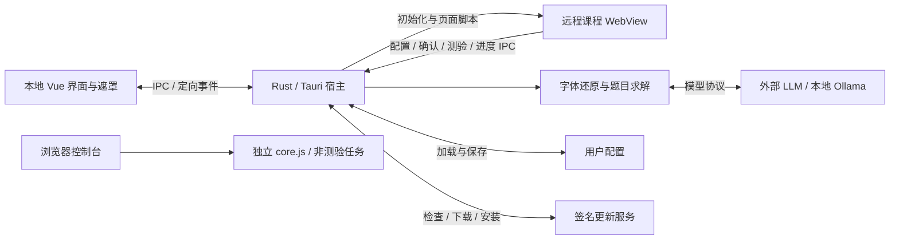

# 架构概览

uXueScript 有三个运行环境：本地 Vue 界面、Rust/Tauri 宿主、远程课程页面。课程自动化脚本另有可直接复制执行的浏览器模式。理解它们的职责与通信边界，是修改项目的起点。

## 宿主、界面与 WebView

Rust 宿主拥有窗口、配置和共享状态；Vue 界面通过生成的 IPC 客户端操作它们。课程页面运行在独立的远程 WebView 中，不属于 Vue 的 DOM。

| WebView | 职责 |
| --- | --- |
| `main` | 本地配置、课程仪表盘与导航控制 |
| `chaoxing` | 学习通页面与课程自动化 |
| `mask` | 全窗口开屏、确认、退出和更新下载展示 |
| `chaoxing-mask` | 覆盖课程区域的启动确认 |

窗口与各 WebView 在开屏前已创建，课程页也已开始导航。遮罩监听就绪后显示窗口，动画再显示内容；显示内容不触发课程页重新加载。课程确认与全窗口确认分别处理，课程导航开始时结束旧页面的确认。

课程页与课程遮罩共享原生位置和尺寸，并与 Vue 的比例布局对齐。调整课程区域时，需同时检查原生几何和 CSS；仅改变其中一侧会破坏覆盖关系。

Windows 主窗口始终保持全屏。Tauri 会把网页退出 HTML 全屏转成父窗口的 `SetFullscreen(false)` 消息；窗口模块通过运行时插件在执行前消费发往 `app` 的这类排队消息，使视频退出全屏时不改变主窗口尺寸。该插件使用不稳定的运行时接口，`tauri-runtime-wry` 固定为 `2.12.1`；升级 Tauri 时需同步复核事件分发与消息拦截位置。

课程仪表盘消费定向发送到 `main` 的进度事件，不独立查询平台完成状态。页面加载完成时先重置状态，课程脚本启动后再持续报告。共用的遮罩组件在各自 WebView 内管理展示与事件。

入口：[窗口与生命周期](../../src-tauri/src/app/window.rs)、[WebView 创建](../../src-tauri/src/app/webview.rs)、[主布局](../../src/layouts/TheMainLayout.vue)、[遮罩交互](../../src/TheMaskManager.vue)。

## IPC 与权限

Rust 命令声明是注册、TypeScript 绑定和应用命令权限的共同来源。`uxs_commands` 扫描命令模块，生成 handler 与各 WebView 的 allowlist；绑定通过 Tauri Specta 导出。修改命令或 DTO 应沿此管线同步，不手改生成文件。

能力按 WebView 标签及远程来源配置。课程页不会因与主界面共享窗口而继承主界面的权限；其有效能力还包含显式授予的插件权限，不能只看应用命令 allowlist。允许页面导航的 URL 分类与允许远程 IPC 的来源匹配是两套规则，需要分别检查。

入口：[命令声明](../../src-tauri/src/commands.rs)、[生成宏](../../src-tauri/crates/uxs_commands/src/lib.rs)、[能力配置](../../src-tauri/capabilities)、[前端绑定](../../src/services/cmds.ts)。同步操作见[构建指南](../development/build.md)。

## 配置归属

| 数据 | 归属与生效方式 |
| --- | --- |
| 版本、应用标识、更新端点及安装器共享值 | `config/build.json` 经同步脚本写入各构建配置 |
| 应用显示信息、课程首页与安装器参数 | 运行时读取已同步的 Tauri 配置或包信息 |
| 模型、课程选项、主题等用户偏好 | 加载到 Rust 配置状态，由命令修改并保存到本地 TOML |

界面操作先修改内存配置，显式保存和正常退出才写入磁盘。加载时补齐缺失的内置供应商；用户配置中的 `version` 用于升级迁移，不决定应用显示版本。升级时会刷新已有内置供应商的模型预设，并尝试按名称保留模型选择，自定义供应商不走此刷新。

设置界面通过 [`useConfig<T>`](../../src/composables/useConfig.ts) 统一提交与回填，每次操作结束后重新读取宿主配置，包括校验或命令失败的情况。数字输入使用 [Zod schema](../../src/composables/useConfig/schemas.ts) 转换和校验；通用请求参数保持非零 `u32` 范围，课程数字设置允许留空关闭。错误弹窗等待确认期间，界面仍会回填当前配置。

API Key 的日志格式化会脱敏，配置序列化仍保留明文。读取或解析配置失败会回退默认配置。

入口：[用户配置与迁移](../../src-tauri/src/config.rs)、[配置命令](../../src-tauri/src/commands/config.rs)、[宿主配置](../../src-tauri/src/app/config.rs)。

## 课程自动化与独立脚本

注入分为两个阶段：WebView 初始化时安装日志、frame 环境适配和课程元数据采集脚本；页面加载完成后，再按 URL 分类注入课程核心或登录辅助脚本。元数据采集在所有 frame 安装，在 HTTPS 超星页面发现课程列表容器后启动详细监听，不限定个人首页。顶层列表直接保存，子 frame 列表由超星顶层授权后通过消息转发保存；容器延迟插入或整体替换由轻量结构监听发现，不由加载完成回调按课程概览 URL 注入。

`core.js` 通过章节、页签和任务 iframe 遍历驱动页面，任务处理依赖学习通 DOM。选择器、等待和失败处理留在这条执行链中；桌面端的逐 frame 环境适配由初始化脚本承担，核心脚本在确认启动后也会处理所在窗口的失焦行为。

单文件是交付契约：课程入口同时生成可直接复制到浏览器控制台的可读 `core.js`，以及由 Tauri 嵌入并注入的压缩版本，两者来自同一份源码。桌面模式增加配置、异步确认、测验求解与进度 IPC；独立模式使用默认配置和原生确认，处理支持的非 Quiz 任务。重构不能引入破坏直接复制执行的模块依赖。

脚本报告的 `finish` 表示执行流程结束，不代表后端独立核验了平台全部任务。视频/PDF 处理还会等待页面的任务完成标记，不能把动作执行完毕与任务点完成混为一谈。

入口：[注入调度](../../src-tauri/src/core/script.rs)、[URL 分类](../../src-tauri/src/core/url.rs)、[核心脚本](../../injected/chaoxing/course.js)、[元数据采集](../../injected/chaoxing/course-list-metadata.js)。

独立作业页使用 [work.js](../../injected/chaoxing/work.js)：在超星域名校验后，按 `/mooc-ans/mooc2/work/dowork` 精确路径识别并注入，不限定具体子域。确认后默认调用共享的 [整页答题流程](../../injected/chaoxing/questions/page.js)，一次提取、求解并按显示题号填写，再调用页面原有暂存流程；收到成功回调后提示自行提交。无 Tauri 后端时提示后退出。

独立考试页使用 [exam.js](../../injected/chaoxing/exam.js) 分流：普通题目页优先调用平台 `topreview()` 进入 `/mooc2/exam/preview`，预览页确认后与作业共用整页答题流程；页面明确显示“不允许整卷预览”时，使用 [逐题流程](../../injected/chaoxing/exam/paged.js)。URL 分类支持 `/exam-ans` 和 `/mooc-ans` 下的题目及预览路径。分流参考 [OCS 的 cx.ts](https://github.com/ocsjs/ocsjs/blob/5.0/packages/scripts/src/projects/cx.ts)；预览页完成后提示用户自行检查、保存和交卷，不调用未经确认的整卷暂存接口。无 Tauri 后端时提示后退出。

整页与逐题流程复用题目提取和填写，支持单选、多选、判断、填空、简答、计算和连线题。其他未支持题型保留原答案，结束时列出需人工处理的题号。连线题向模型提供两组文字及显示编号、字母，答案使用 `1:G;2:A` 格式；前端按文字映射当前页面的内部标识，再点击下拉选项，由页面选择事件维护答案。

考试跨页进度通过 `sessionStorage` 按考试及答卷 ID 隔离，存储采集或填写策略、当前题号、题目、答案及首次加载的必要配置。每个页面依次初始化、执行和结束：初始化恢复进度与配置，执行当前题的采集或填写，结束时推进题号；采集末题后等待整卷求解，再切换填写并回到首题。刷新当前题时继续存储的步骤，手动偏离存储题号直接报错，不自动纠正导航。翻页调用页面原有 `getTheQuestionByStart`，保留其暂存及签名导航流程；最后一题调用 `submitForm(true, false, callback)`，收到回调后清理进度并提示人工交卷。失败停止当前流程并报告策略和题号。仅支持可自由回看的普通考试，保留平台倒计时和到时提交行为。

## 测验与模型

章节测验、作业和考试共用前端题目提取器，通过选择器配置适配题号、题型、题干和选项的位置。整页题目直接组成列表，考试逐页累积后提交；分页方式和平台内部 ID 不进入求解协议。加密字体从页面内嵌样式读取为字节数组。

题目从 JS 提取、IPC、Rust 到模型输入统一使用 `id / kind / stem / options / images` 字段；`id` 表示页面显示题号。超星公式图片带有可解析元数据时写入 `stem` 或 `options` 的公式占位文本，其他图片以 `[图片N]` 保留原位置，并由 `images` 提供地址；后端下载后按模型协议发送多模态内容。模型答案使用 `index / explanation / content`，`index` 对应输入的 `id`，不在链路中转换中英文字段。

三个入口统一调用 `solve_questions(payload)`，请求结构为 `QuestionPayload { questions: Vec<Question>, font: Option<Vec<u8>> }`。Rust 有字体时按字形路径还原文字，无字体时直接使用题目列表，再按配置的模型协议分批求解；生产入口不解析整页 HTML。字体映射针对字形，不是整个字体文件的哈希；未匹配字符保留原样。章节测验开启人工核验时，在提交前等待用户确认；独立作业和逐题考试仅暂存，整卷预览考试提示用户自行保存和交卷。

提供商配置是数据，协议分发负责请求与响应处理。后端支持的协议范围与配置界面允许编辑的范围不同，不能由后端类型推断 UI 已提供全部入口。

通用配置保存请求并发数和每批题数，对所有模型生效；缺省为并发 10、每批 5 题。设置沿现有配置保存流程持久化。每次求解读取通用配置，修改从下一次求解生效，按批次创建顺序汇总结果。首次收到 HTTP 429 时，本次求解的请求池收缩为 1，已发出的请求正常结束，后续批次和重试串行发送；新一次求解仍从配置的并发数开始。HTTP 429 最多重试 3 次，同一次求解的各批次共享冷却时间，恢复发送时至少间隔 250 毫秒；整数秒 Retry-After 优先，否则使用 1、2、4 秒退避。答案 JSON 或完整性校验失败时，仅该批次最多额外请求 2 次，成功批次不重跑。网络错误、其他 HTTP 错误（包括内容审核拒绝）不自动重试。

答案严格解析为数组或 `answers` 对象，校验数量、题号和非空内容，并按输入题号排序。Chat Completions 配置 `json_object` 时，提示词明确要求 `answers` 对象；Responses 与其 JSON Schema 保持同样约定。所有批次结束后仍有失败时，返回成功题数、失败批次及具体原因，不回填或自动提交。成功结果仅在本次调用内保留，不支持跨调用恢复。

入口：[前端提取](../../injected/chaoxing/questions/extract.js)、[请求结构](../../src-tauri/src/core/quiz/payload.rs)、[测验处理](../../src-tauri/src/core/quiz.rs)、[协议分发](../../src-tauri/src/core/quiz/llm/dispatcher.rs)、[供应商交互](../../src/composables/useLLMProviders.ts)。

## 更新与分发

开屏结束后由主界面发起更新检查。前端负责提示和安装方式分流，Rust 使用 Tauri updater 检查、下载和安装签名包；检查所得资源由发起调用的 WebView 持有，前端在流程结束时释放。

Windows MSI 安装通过注册表标记识别，便携版转到下载页。下载可取消，进入安装阶段后不再走下载取消；安装前复用正常退出的配置保存与动画收尾。

GitHub 与 Gitee 分发同一组构建产物和签名，镜像清单改写下载地址。端点顺序影响更新检查；选中某份清单后的下载失败，不会自动改从另一端点下载。

入口：[前端更新流程](../../src/composables/useUpdater.ts)、[宿主更新操作](../../src-tauri/src/commands/updater.rs)、[发布工作流](../../.github/workflows/release.yml)。发布与镜像操作见[发布指南](../development/release.md)。
